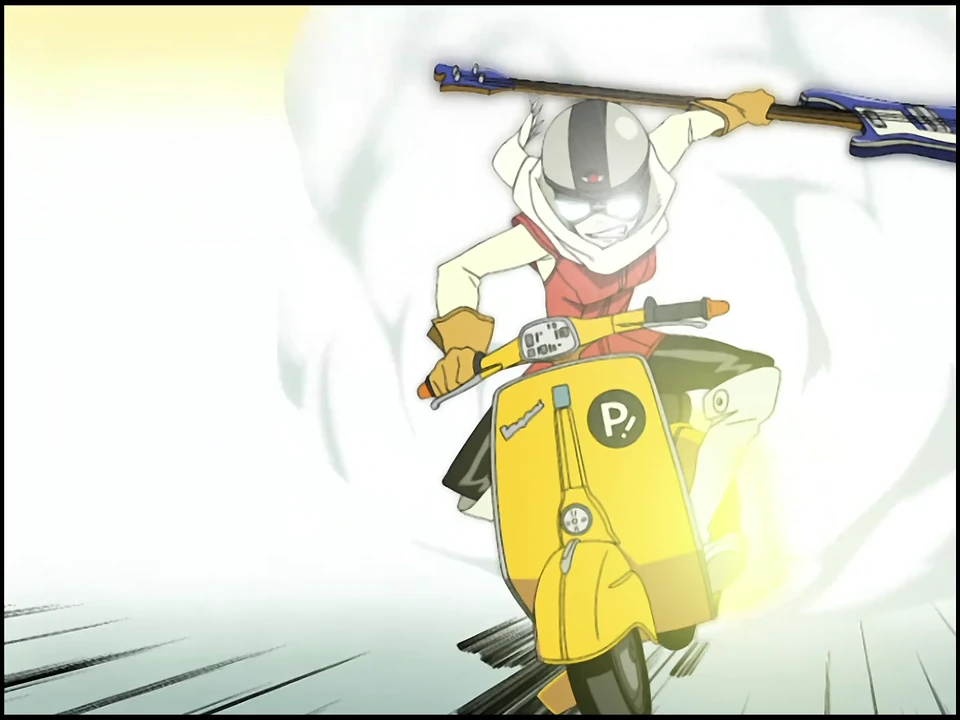
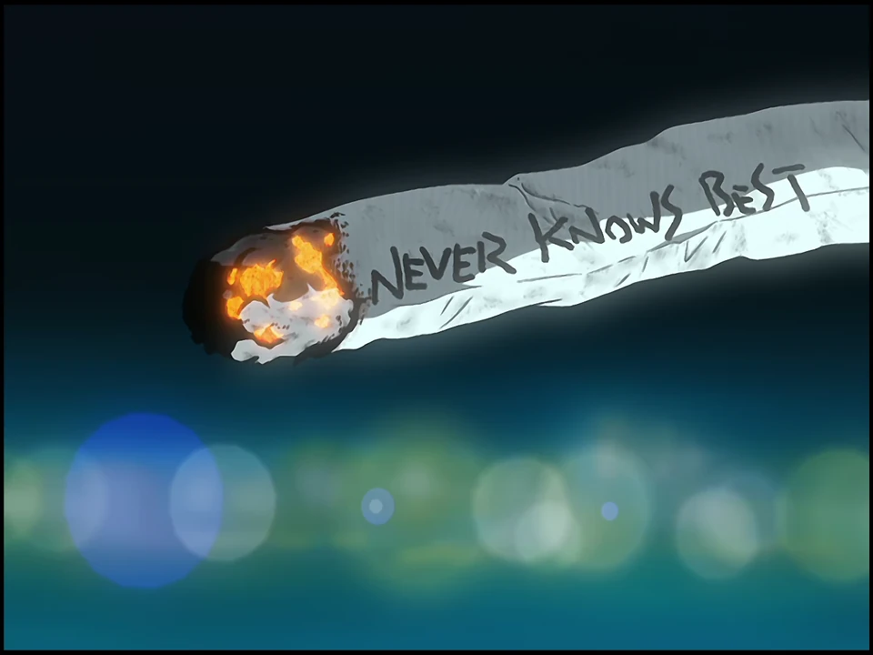
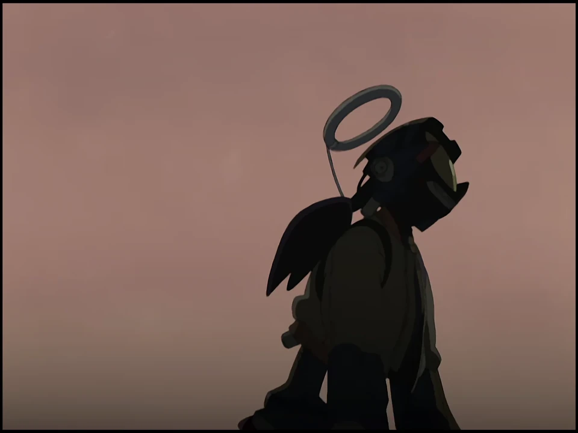
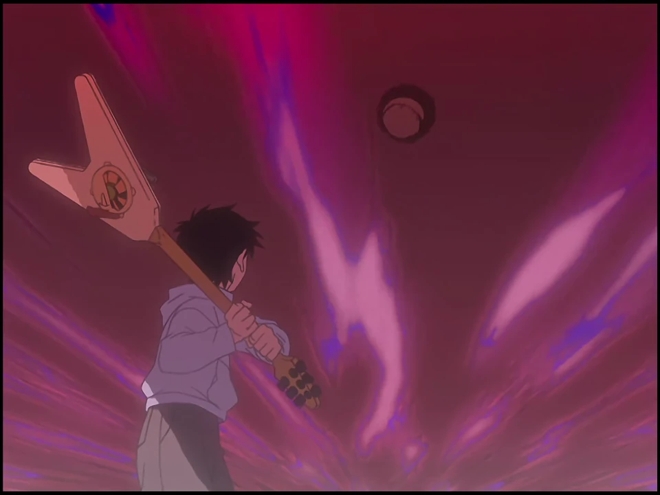
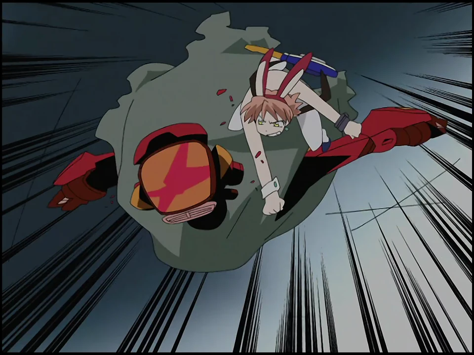
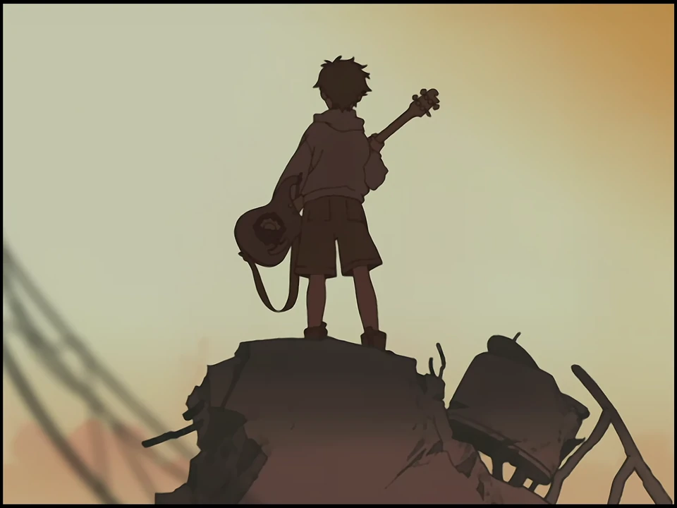

## 一、从中二开始

小时候看动画，总觉得那些喊着热血台词的角色帅得不得了。什么“我的钻头可是能突破天际的啊”，什么“人类的赞歌就是勇气的赞歌！”。

我们当然知道，现实不是热血动画，不是说了永远不分开，就真的能永远在一起。但即使现在觉得这些口号有点中二有点羞耻，好像也不妨碍我们喜欢这些东西。或许正因为知道它们有多荒唐，反而能感受到其中的真诚。

<!-- more -->

《FLCL》的故事开始于骑着摩托的怪女人晴子突然闯进了小学生直太的生活。晴子驾驶着 Vespa 摩托车撞向直太后，又挥舞着贝斯敲向了直太的脑袋。于是直太脑袋上竟然长出了角，还能往外钻机器人。

还没等观众反应过来，故事就如同脱缰的野马，自顾自地狂奔下去。它像是一段混乱、躁动又有些酸涩的胡闹，却也如一场摇滚现场，硬生生撞击着人的耳膜与心脏，让人只想跟着一起呐喊。如果非要用所谓成长叙事去套它，或者掉书袋式地把里面的隐喻逐一拆解，我想反而会漏掉它最迷人的部分，那种击碎所有异质感后才有的狂气。

<!-- 原片截图：《FLCL》第 1 话 00:03:40.500 -->

## 二、在成为好大人之前

在《FLCL》最初的企划书中，鶴卷和哉与榎户洋司曾写下过一句话：**「在成为一个好大人之前，先成为一个好小孩吧。」** 在《FLCL》的世界里，不需要急着成为好大人，因为成人世界也显得并不正确。比如直太的父亲好色、不靠谱，有时比直太更任性。可出于各种各样的原因，小孩们还是急着模仿所谓成熟的大人。

直太整天板着脸，装作对什么都无所谓，仿佛只要不表现出幼稚的感情，自己就能比周围的大人更加成熟。

但这种故作成熟，反而让他在面对感情时显得格外被动。

真见美曾经是直太哥哥的女友，哥哥去了美国之后，她却依然叫着直太那个熟悉的昵称“Takkun”，把他当宠物一样亲昵地摆布，以填补心中的空缺。

直太当然不是完全没有察觉。他会不满，会害羞，但内心对真见美的喜欢让他放下了抗议，反而更想扮演起哥哥的角色，去保护她。

抽着写有 **“Never Knows Best”** 的烟的真见美，则是给自己搭起了一个小小的世界：这里有熟悉的称呼，有游戏里的神，有别人不懂的仪式，也有自己愿意相信的故事：原来，真见美的学校曾遭遇火灾，那次真见美被直太哥哥拯救。于是她在直太哥哥离开后，玩《Fire Starter》，在小镇纵火，把从直太头里出现的机器人 Canti 认作黑炎之神。游戏、火灾和回忆拼成了她相信的故事。她反复点燃火，仿佛只要火焰重现，那个救过自己的人也可能回来。

真见美像在反复演一个已经结束的昨天。烟上的 Never Knows Best 也是真见美迷茫内心的写照。已经不知道什么才是最好的路了，只能在对过去的重复与怀念里寻找安全感与安慰。

<!-- 原片截图：《FLCL》第 1 话 00:16:20.000 -->

## 三、Canti

纵火的真见美究竟要烧掉什么？她当然不能把整座小镇烧光；那样连自己的容身之处都没有了。而每一次火灾过后，旧时光也不会真的回来。她只能靠仪式化的重复来维持过去与现在之间越来越微弱的联系。这样的战斗注定没有漂亮的胜利。

真见美眼里，机器人 Canti 像神明大人，而在直太眼里，红色形态的 Canti 又像那个远在美国、无所不能的哥哥。导演音轨也提到，这种红色的强大形象承载着直太对哥哥的理想化。一个想找回过去的保护，一个想借到未来的勇气。他们都在利用幻想，试图获得现实中缺乏的力量。

<!-- 原片截图：《FLCL》第 2 话 00:07:14.000 -->

《FLCL》中借助 Canti，让直太想要的强大真的出现，真见美想要的神真的长出翅膀来拯救她。中二病的幻想成真了，短暂的让他们遗忘了现实的无力感。但是问题并没有被解决，只是直太和真见美把自己的情感又投射到了 Canti 身上，直太想着这样或许自己就可以一直陪伴在真见美身边了吧，而真见美则又将自己希望被拯救的愿望投射到了 Canti 身上。说他们逃避现实似乎是个有些严厉的批判，但他们确实都没有面对自己的感情。直太没有勇气卸下哥哥替身的伪装，去坦率表达自己——无论是对真见美的喜欢，还是对晴子的迷恋。

## 四、挥棒！

**「不挥棒的话，什么也不会发生。」** 直太拿着哥哥留下的球棒，却从来不挥。哥哥在美国打棒球，出色、受人仰慕，当然是一个值得敬佩的榜样。但直太抱着球棒，就像抱着一份不属于自己的成就。他当然想证明自己，但自己真的有所谓的才能吗？万一挥出的球棒打不中球呢？

导演鹤卷和哉在动画的评论音轨里谈到：只要不挥棒，直太就可以永远保留一种如果出手，也能打出全垒打的幻想。没开口的表白，没登场的演出，没挥出去的那一棒，永远有机会在想象中获得完美结局。可只要真的行动，就意味着要面对失败的可能。直太害怕面对幻想中的自己变成一个普通的、会失败的小孩。

不挥棒是一种自然的回避，是一种自我保护。直到直太意识到如果不挥棒的话一切都可能会失去，真见美激动地抛下直太去看 Canti 的棒球赛；晴子好像不再需要直太而是需要直太老爸。终于球飞过来了，一切感情得到了一个可以宣泄的出口。直太明白了，挥棒原来是很简单的事情，意识到的时候，手握的球棒已经挥出去了，意识到的时候，只有手掌上残留着麻痹的感觉。

<!-- 原片截图：《FLCL》第 4 话 00:19:40.000 -->

这一棒也打破了真见美熟悉的关系。她能够把直太当宠物般亲近、摆布，部分正是因为她知道他不会反抗。如今他突然有了自己的动作，她没法再让直太永远停留在那个“Takkun”的位置。直太的变化，对他自己或许是迟来的主动，对真见美却是又一次失去控制。再想留在原地，已经不可能了。

## 五、Rock and Roll

人为什么明知自己可能挥空，还要冲出去？这像极了尼采对生命那股近乎暴烈的肯定，既然算计不出体面的退路，那就把理智砸个稀烂，在行动的阵痛里认领自己全部的狼狈。塞林格笔下的少年也是一边鄙夷着大人们的油腻与虚伪，一边又只能借用大人的冷漠伪装坚强；一旦那层假壳被撞破，剩下的就只有赤裸裸的躁动与渴望。

《FLCL》到了第五集，索性连解释都省去了，讲故事的方式彻底变成了一场毫无保留的释放。

前面四集，人物那些不愿承认的感情，还藏在香烟、眼镜、游戏和眼神里。含蓄而别扭。可这些积蓄都是为了现在的释放。晴子直接揪出躲在幕后操控局势的海苔眉毛男，从他头中揪出的东西小得可怜，和直太头里惊人的力量形成对照。真见美也不再掩饰自己烦躁、嫉妒、失落的情绪，将枪口对准了从前任她摆布的直太。动画仍然没有停下来解释原因，但即便看不懂人物复杂的内心，我们也能直观感受到画面的张力，画面在枪口间切换，吉他挟着炮弹砸向了巨大的机械手。即使你不懂剧情中反派 Medical Mechanica 的阴谋，不懂那熨斗想要熨平的是所有人的棱角，仍然能够感受到极致的情绪宣泄。

<!-- 原片截图：《FLCL》第 5 话 00:17:52.000 -->

除了得益于今石洋之原画带来的狂野的几何变形和夸张的身体扭曲，the pillows 的音乐也让高潮的情绪更上一层楼。或者可以说看《FLCL》的体验就是很类似听一张专辑。相同的曲目在不同场景里反复出现，但同样的音符一遍遍积累躁动和冲劲。人物越来越少用台词解释自己，歌曲的情绪却被堆叠的越来越满，直到高潮时的释放。伴随着 *Little Busters*（小破坏者们）的响起，我们也从画面看到了这些少年是如何 sing out the future 的。*Hey，kids don't need the masters*（孩子们不需要主人）！看小孩如何用吉他砸烂那大手吧！现在大概能明白鹤卷为什么会在企划书里写下「在成为一个好大人之前，先成为一个好小孩吧」了吧。

有趣的是，鹤卷当年是直接把 the pillows 的旧专辑拿过来，“照着音乐的鼓点和吉他失真去卡分镜的帧数”。主唱山中泽男后来在访谈里回忆，当他看到《Little Busters》和《Ride on Shooting Star》被放进那种近乎癫狂的画面里时，才意识到自己歌里那些关于小破坏者们（Busters）的躁动，被这群动画疯子用视觉彻底翻译出来了。

这不就是一场彻底的摇滚演出吗？穿着的服装也许是模仿来的，喊出的宣言也可能早就被别人喊过千百遍。人工搭出来的舞台，音箱在疯狂啸叫，台下的人也清楚散场后还得回到各自无聊的日常。可在鼓点砸下来的那几分钟里，已经不再需要理性了，只需要把所有的音量拧到最大。我在胡闹，我在嫉妒，我在不甘心，我在恐惧，我在爱……这就是少年们的真诚。

小孩说不清楚的东西，就让机器人和失真的电吉他替他嘶吼。我们都知道那是什么，那是内心的呐喊。

## 六、谢幕

可是演出终要散场，我们被躁动点燃，又将因为季节的变化而怅然。

虽然结尾伴随着《I Think I Can》的音乐，直太吸收爆发了海盗王的力量，以超级系的方式解除了小镇的危机，也直率地对晴子说出了“我喜欢你”，可这句话并不能让晴子留下。直太只能背着吉他，盯着晴子逐渐远去的背影。晴子仍然要去追逐自己的目标。真见美终于停止了自己把每个能抓住的东西都叫作“Takkun”的仪式，不再反复困于过去，而是拍下直太的背影，离开小镇。这是成熟也是告别。

<!-- 原片截图：《FLCL》第 6 话 00:27:20.000 -->

蜷守干净利落的跳过了加高了十厘米的横杆。演出结束之后是 Another morning，生活还在继续。

不管是直太的装成熟、还是蜷守的眼镜、真见美的纵火、每个人都曾借助一点夸张的幻想应付眼前的人生。Never Knows Best 是怀疑是迷茫，却也是开辟未知未来的勇气。

我们总习惯替青春补上一句意义：看作是成长的必经阶段，那些失败使人变得成熟，那些磕碰最终都有意义。可没必要这么解释《FLCL》。或许某些愿望从一开始就不可能兑现，某些人即使努力了，也还是会离开。但是挥棒是一件好事啊，也许是最好的事，而美好的事物永不消逝。青春时盛大的荒诞和不完美的落幕共同结出了一段浓郁的浪漫。

然后曲终人散，生活继续。但角落里的吉他仍然在发出颤音。
