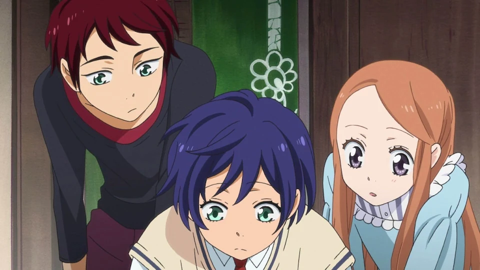
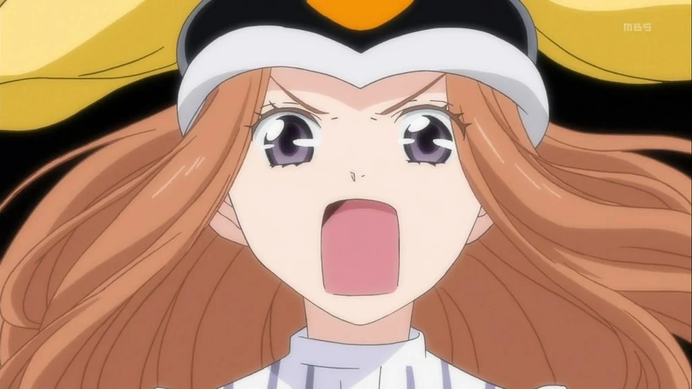
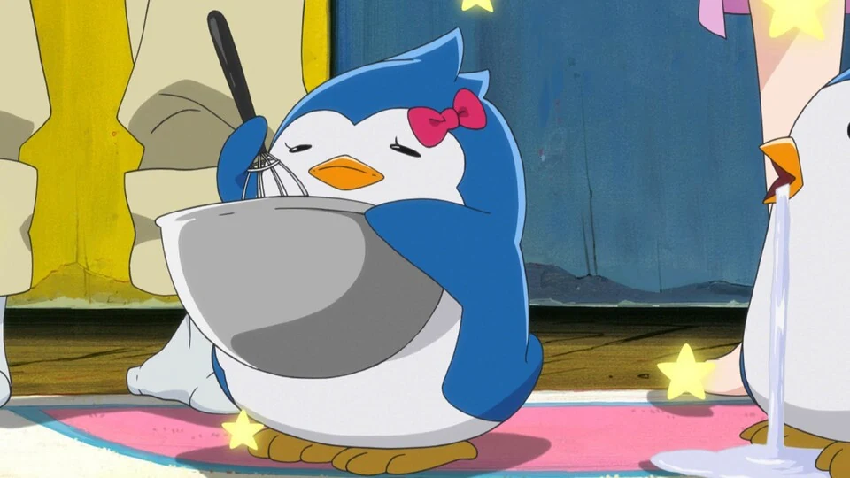
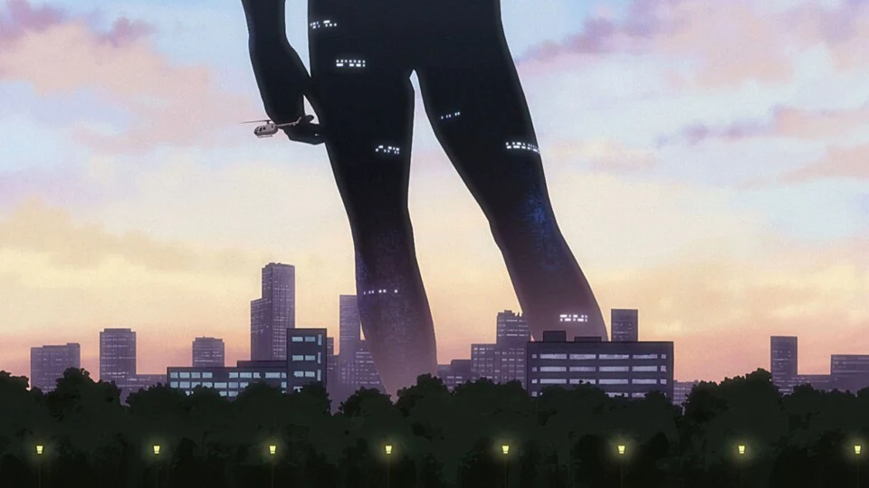
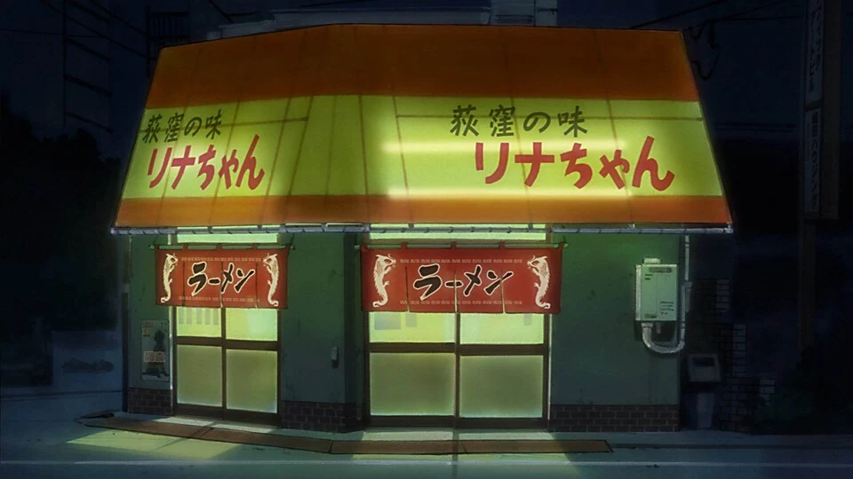
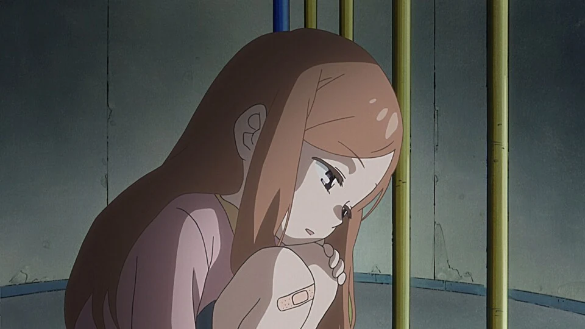
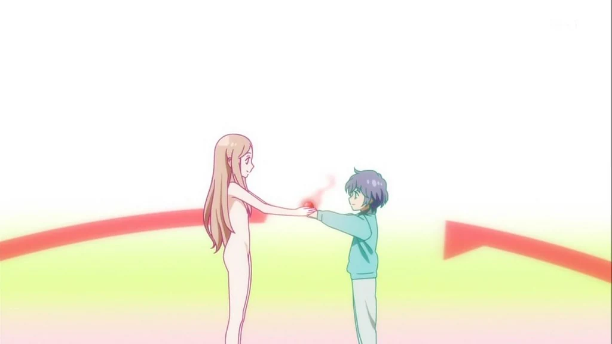
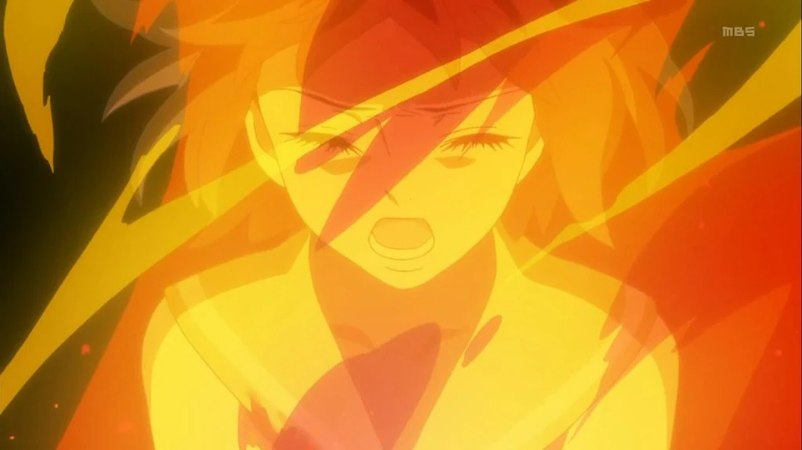
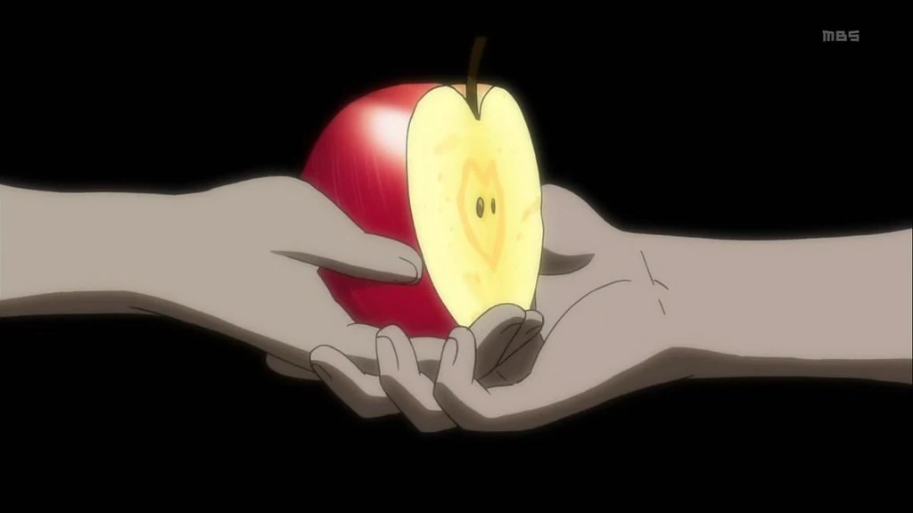
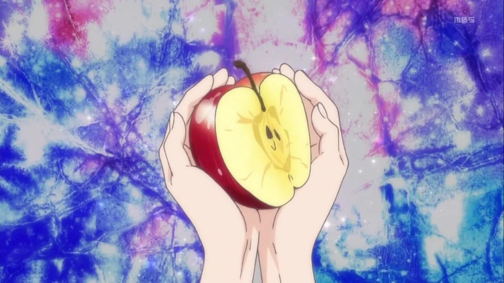

## 一、被逐出乐园的人

在《圣经·创世记》中，亚当与夏娃吃下禁果，获得了分辨善恶的知识，但也因此被逐出伊甸园。从此，人必须要面对劳累、痛苦，以及终有一天会到来的死亡。

这是世界上第一对男人和女人的故事。他们受到了惩罚。「所谓活着，就是一种惩罚吧。」在《回转企鹅罐》中，阳毬这么说。

阳毬的病情让她不得不面对死亡，而她的两个哥哥则拼命想要留住她的生命。为什么只是一个「光和家人一起吃饭就会说幸福的女孩」却要承受这样的命运？那神明可就太不讲道理，太残酷了。这一问题在开篇就被抛到了观众的面前。

*高仓家的三兄妹*

<!-- 图片来源：https://www.b-ch.com/titles/3033/001 -->

<!-- more -->

紧跟着问题的不是解答而是一顶突然出现的会让少女变身的企鹅帽。它要求哥哥冠叶和晶马寻找神秘的「企鹅罐」，并且告诉他们：如果不完成任务，阳毬就会死去。

于是一段为了拯救阳毬的生命而展开的冒险开始了。奇迹是否存在？神秘的企鹅罐究竟是什么？第一话中其实已经借两位小孩讨论《银河铁道之夜》的对话给出了回答的一半：「苹果是对那些为爱而献身之人的奖励。」什么？你不明白吗？「是关于爱的话题，你怎么就不明白呢！」但是这一场景直到最后一话才结束，我们必须先跟随主角们穿过一段段故事与回忆，才能在最后恍然大悟，那枚命运的果实究竟是什么。

而在谈论奇迹之前，我们得先看看，为什么在这部作品里，活下去竟然会是一件如此艰难的事。

*企鹅帽与生存战略*

<!-- 图片来源：https://paradisedistant.wordpress.com/2011/12/23/mawaru-penguindrum-24-final/ -->

## 二、注定一事无成的孩子

「致注定一事无成的你们。」这句反复在作品里出现的残酷的否定在作品中对应一个同样残酷的场景：小孩子粉碎机。

那些没有被选择、没有人需要的孩子，被送往一座像工厂一样运转的设施。在那里，他们被处理成透明的存在，仿佛从未在世界上留下过痕迹。

当然这一场景可以被作为隐喻解读：不被人爱不被人需要的孩子，被家庭和社会认为没有价值，从而遭到残酷的抛弃的孩子，是被社会边缘化的群体，会逐渐被遗忘、变得透明。

但是即使抛开隐喻，这一场景本身也足够有力量：它让我们暂时站到孩子的感受里，看到这个世界在他们眼中可能有多么冰冷，乃至同样体验被抛弃的恐惧与无助。

《回转企鹅罐》是一个关于孩子的故事但又不仅是关于孩子的故事：因为每个大人都曾经是孩子。比如已经成人的时笼百合、多蕗桂树、渡濑真悧。而小孩子粉碎机这一舞台装置，则让我们回到童年，去理解他们的过去。这也解释了《回转企鹅罐》的所谓意识流也好舞台感也好的一种独特之处：它奇幻荒诞的场景并不是为了营造一个完全与现实独立的异世界幻想国度，而是某种隐藏在现实中的东西因为舞台而得以获得自己的形态，或者说现实本身仿佛就有产生这些荒诞事物的能力。

同样是象征，三只企鹅恰好提供了反方向的答案。它们会闯祸、贪吃，常常帮不上任何忙，却仍然让高仓家的日常多了许多热闹与温度。一个生命是否值得被接纳，难道一定要先证明自己有用吗？在几原的演出里，这些滑稽的小家伙，提供了一种微小而幸福的日常生活的视角，从而带来一种简单而容易被感受到的温度。

*日常生活中忙着吃东西的企鹅*

<!-- 图片来源：https://www.b-ch.com/titles/3033/004 -->

同时我们看到作品对角色童年的描写也确实影响了角色长大后的性格。

时笼百合的父亲把自己对美的偏执强加在女儿身上。对小时候的百合来说，「我是什么样的人」，从来不能由自己决定，而是必须经过父亲的评判。多蕗在母亲对才能的期待中体会到被替代的恐惧。真砂子所继承的家族秩序，则把竞争、占有和保护揉成了难以分开的东西。

*百合童年记忆中笼罩城市的巨大雕像*

<!-- 图片来源：https://www.b-ch.com/titles/3033/015 -->

当然还有苹果。她拼命按照姐姐桃果留下的日记行动，表面上像是在执行荒唐的恋爱计划，实际上却是想回到姐姐仍然活着、父母还没有分开的过去。她是如此认真地扮演一个早已不在场的人，正因为她无法接受失去之后的生活。

这些人物的不同经历把他们塑造成了不同的性格。有人渴望被承认，有人试图夺回失去的关系，有人害怕再次被抛弃。

于是命运也不再只是一个静态的剧本，舞台的演员是一个个被过去塑造的角色。每个人都在用自己的方式理解世界，理解爱与家庭，理解自己在这个世界上的位置，乃至用自己不同的方式去理解命运。童年时未曾能射出的「糖果子弹」并不会消散，它们会在长大后以不同的方式影响着每个人的选择与行动。

那么，究竟是什么支撑着这些孩子们没有变透明、继续活下去呢？是对未来的期待吗？是对过去的怀念吗？还是对他人的爱呢？我们接着往下看。

## 三、每个人都在讲述自己的命运

对于这个问题，《回转企鹅罐》让不同人物轮流走上舞台，演出他们的故事、他们的回答。

苹果相信日记，因为她需要相信，姐姐留下的命运仍然能够执行，破碎的家庭还有复原的可能。百合和多蕗将桃果的存在视作无法替代的光，因此他们对于失去的回应，又和苹果有了微妙的相似之处。真砂子想保护马里奥，也想守住与冠叶之间难以割舍的联系。

这些人没有先想清楚「命运是什么」，然后才决定如何生活。而恰恰是他们的愿望与创伤，塑造了他们各自相信的命运。而一旦相信，命运又反过来成为他们行动的理由。前半段苹果的故事中，尽管她自己都在怀疑对多蕗的爱是否真实，但她仍然按照日记的指示去行动，这是她所相信的命运。而这一行为又只是因为她想要守护自己所爱的人。

最后的冠叶尤其如此。他为了拯救阳毬付出的感情是真实的，愿意承担的代价也是真实的。可这份爱逐渐与他对过去家庭的执着缠绕在一起。第 21 话那间破落的小店中，现实中已经无法再相见的父母，在冠叶的想象里仍然坐在那里。对他而言，那除了怀念，更像是一个必须继续相信下去的故事。否则，他就不得不直接面对，自己至今拼命守护的究竟是什么。

*冠叶记忆中的拉面店*

<!-- 图片来源：https://www.b-ch.com/titles/3033/019 -->

真悧最可怕的地方正是他能利用这种执念。他没有凭空制造冠叶的痛苦，只是引导他：这世界本来就错了，你的不幸都有原因，而我知道怎样把它纠正。于是，为了爱一个人而不惜一切，和与为了实现某种理想而伤害他人，出现了危险的重叠。这里我们来欣赏一段真悧的反派发言：「为了妹妹，将被爱所折磨的你烧上一百遍，然后你会剩下什么？烧得焦黑的丑陋天蝎心脏？还是纯净洁白的爱？」

这里又联系上了真悧和桃果对立的线。他们同样都能看见人是如何被命运所束缚的，但他们的选择却完全不同。桃果选择了牺牲自己，为别人创造新的可能；真悧却选择了让他人服从自己的答案，去改变世界。

这些故事彼此交错，就像一根根尚未连接起来的红线。我们先看到每个人执拗的一面，再理解他们为什么无法放手。虽然每个人都很痛苦，但痛苦彼此纠缠反而创造出了更多新的痛苦，如此的苦痛循环。

但苦痛中亦有希望。在这些越缠越紧的关系中，转折点出现了。

## 四、命运的相遇

我很喜欢第 20 话中晶马和阳毬的相遇。

此前的作品充满人工化的舞台：企鹅的变身、车站的标语、透明的孩子、不断变换的象征空间。但那一话的城市却显得格外安静。两人只是普通的相遇、一起偷偷喂养一只小流浪猫。然后流浪猫被垃圾车收走、阳毬即将被带去小孩子粉碎机，晶马在雪中奔跑，想救回阳毬。到此都只是普通的城市场景，雪落在普通的街道和住宅之间，遮住日常生活里琐碎而杂乱的痕迹。奇幻的法则都消失了，但现实却忽然变得像童话一样神圣。

晶马和阳毬谈起亚当与夏娃吃下果实、被逐出乐园的故事，也由此把生存理解为惩罚。但阳毬其实一直渴望生活中的温暖，只是太早学会了不要期待，因为期待本身就意味着可能再次失去。阳毬说：「你第一次跟我说话的时候，我其实是非常开心的。我第一次觉得……『等待』也并不是痛苦的。」

年幼的阳毬等着一个不会回来接她的人。她因为晶马的出现和一起养的流浪猫而曾经短暂地感受到温暖。可当这份温暖再次失去，她便觉得自己终究还是没有被选择。既然不被需要，消失似乎就成了世界替她作出的决定。

*童年时独自等待的阳毬*

<!-- 图片来源：https://www.b-ch.com/titles/3033/020 -->

这时晶马追来了。向她伸出手，邀请她一起分享命运的果实。在那个瞬间，他们选择成为彼此的家人。原本由血缘、出身与上一代的罪责划定的关系，第一次显现出可以被重新选择的可能。

*年幼的晶马向阳毬伸出手*

<!-- 图片来源：https://paradisedistant.wordpress.com/2011/12/23/mawaru-penguindrum-24-final/ -->

这样的命运之人的故事看多少次都会觉得温暖。不管结局如何，同行的时间一定是真实的，一定是曾在心灵中留下痕迹的。

虽然未来也不会因此没有痛苦。但因为你的出现，原本完全不值得期待的明天，忽然有了一点不同。

现在我们又可以回到一开始对《银河铁道之夜》的讨论了。

## 五、燃烧的天蝎之火

《银河铁道之夜》中有一则天蝎的故事。天蝎曾靠捕食其他生命活着；但当自己被追赶、即将死去时，它希望如果生命终究要结束，不如让这具身体燃烧，成为照亮他人的火。于是，天蝎之火留在星空中。一个生命愿意超越自身，为别的生命带来幸福的心意。

这趟银河之旅背后，也有一段现实中的失去。1922 年，宫泽贤治与和自己很亲近的妹妹死别。约两年后，他开始创作《银河铁道之夜》，并在此后多年里反复修改。很多研究者认为，妹妹的离世深深影响了这部作品：康帕内拉的角色就受到妹妹很大的影响。

康帕内拉为了救人而消失，但乔万尼却并没有因此获得「真正的幸福」的标准答案。他独自回到人间，带着两人在列车上提出的问题，继续寻找活着的方向。一个人离开了，另一个人的生命却因这段同行而改变。《回转企鹅罐》同样在追问：当给予者已经不在，被留下的人要怎样带着这份爱继续生活？

桃果为了改变他人的命运，不惜承担诅咒的代价。而到了结局，苹果也说出了命运换乘的咒语。苹果的变化尤其让人感慨：最初的她执着于按照日记执行姐姐留下的命运，仿佛只有服从剧本才能让失去的一切回来；而与三兄妹一同经历了种种故事后，此刻，她终于不再只是扮演桃果，而是出于自己心中的爱，主动选择承担改变命运的代价。命运从必须遵守的安排，变成了她愿意对他人作出的回应，她主动的付出。

*说出命运换乘咒语后被火焰包围的苹果*

<!-- 图片来源：https://paradisedistant.wordpress.com/2011/12/23/mawaru-penguindrum-24-final/ -->

冠叶与晶马也以自己的选择，将继续生活的可能交给了所爱之人。这里《回转企鹅罐》就像是《银河铁道之夜》的继续，命运之果实在被给予之后，仍然可以继续传递下去。一个人曾经获得的生命与温暖，可以成为他愿意继续给予他人的东西。这也引出了作品的另一句标语：「无论是我的爱，还是你的惩罚，全都一起分担。」这就是我们一起分担的罪与罚，一起分享的命运的果实。

这里可以和单纯的自我牺牲对照起来看：在一对一的关系中，单向的给予和接受认可会带来世界系式的自我孤立风险，在这种孤立中，一方仅仅依赖另一方而忽略了自身的独立性。只有当企鹅罐开始回转，人们彼此开始接纳对方的爱与痛苦，才有突破孤立的可能。

几原邦彦在与辻村深月的对谈中曾经谈到，《回转企鹅罐》的创作受到 2011 年东日本大地震的影响。面对现实中的巨大失去，他开始重新思考，怎么才能够讲好这样一个关于死亡和惩罚的故事。是啊，在让人无力的震灾已经发生之后，幸存下来的人们还能怎样彼此联系，怎样一起继续生活？作品用华丽的视觉和复杂的象征，给出了一个朴素温暖的回答。

逝去天蝎燃烧的火不会让生命回来。但火焰能够照亮别人；曾经接受过那束光的人，也可以继续把光传递下去。

## 六、一起品尝命运的果实

到最后一集，曾经分散的故事终于连接起来。苹果的名字、桃果的日记、童年的牢笼、荒诞的企鹅帽，以及那列贯穿开头和结尾的银河列车，都让我们重新理解了「企鹅罐」这个最初只像谜题的词。

回头看，「企鹅罐」原来只是一个麦高芬：我们不知道它到底是什么，却因为主角们必须找到它，跟着他们接近苹果与命运日记，又一步步走入百合、真砂子和上一代人的故事。这个被不断追寻的名字，把原本散落的人物和命运串联起来。我们以为一直在等宝物出现，却发现寻找本身已经让我们看见答案。

冠叶曾把命运的苹果分给晶马，晶马也曾将果实分享给阳毬。那些孩子原本可能被世界遗忘，却因为彼此的选择，成为了兄妹一家人。命运的果实从他们决定分享的那一刻起，它就已经存在了。

*在牢笼之间分享的半枚苹果*

<!-- 图片来源：https://paradisedistant.wordpress.com/2011/12/23/mawaru-penguindrum-24-final/ -->

我们作为观众，跟着二十四集碎片般的叙事，一次次进入不同人物的视角，终于看见那些红线怎样在命运中互相连接。起初似乎只属于一个人的痛苦与执念，最后都成为了理解这枚果实不可缺少的部分。

《圣经》的禁果，使人离开无忧无虑的乐园，开始背负有限生命的劳苦；《回转企鹅罐》的苹果，却让身处这种劳苦之中的人，找到与他人共同活下去的理由。同样一枚果实，既是惩罚，也是奖励。

我们未必能成为世界眼中有所成就的人，未必能改变所有不公，甚至未必能与最珍视的人一直相伴。可是，被另一个人选择过、爱过，也曾主动向他人伸出手，这些事难道就什么都不算吗？

又回到了最初的问题：或许，活着真的是一种惩罚。但因为你的出现，因为你带来了命运的果实，我开始稍微有点期待明天了。

那么，我们一起来品尝吧。

一起品尝命运的果实。这是关于爱的话题啊，为什么不明白！愛してる！

*星空下高举的命运之果实*

<!-- 图片来源：https://paradisedistant.wordpress.com/2011/12/23/mawaru-penguindrum-24-final/ -->

『その火は今でも燃え続けているんだよ。』

そう、あれはきっと蝎の火なのです。

来源：[Bangumi 日志](https://bangumi.tv/blog/381850)
